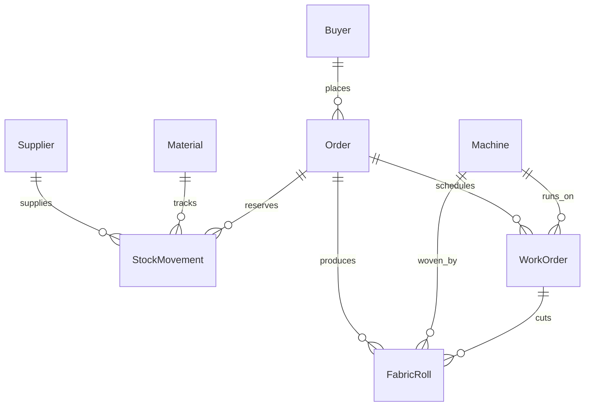

# Warpspeed ERP Prototype Notes

Welcome to the **Warpspeed** textile mill ERP prototype built for Everest Textile Mills. This document provides a plain-English, beginner-friendly guide to every file created, explaining what it is, why it is needed, how the files connect to each other, and how the database tables relate.

---

## 1. File-by-File Breakdown

### `requirements.txt`
- **What it is:** A text file listing all Python package dependencies and their exact versions.
- **Why it is needed:** Enables anyone to install the identical set of required libraries (`Flask`, `Flask-SQLAlchemy`, `Flask-Login`, `pytest`) using a standard package manager.
- **How it connects to other files:** The libraries specified here power the web server (`app.py`), the database ORM (`models.py`, `extensions.py`), authentication (`models.User`), and the test suite (`tests/test_prototype.py`).

### `config.py`
- **What it is:** The central configuration file holding constants, mill operating rates, fabric recipes, and the database file path.
- **Why it is needed:** Avoids hardcoding magic strings and numbers across different modules. Directly implements the specification defined in `CONTRACT.md`.
  - Roles: `owner`, `store`, `supervisor`, `qc`, `buyer`.
  - Lifecycle statuses: `ORDER_STATUS`, `MACHINE_STATUS`, `MOVEMENT_TYPE`, `QC_STATUS`, `WORK_STATUS`.
  - Physical constants: `ROLL_LENGTH_M = 50`, `WASTAGE = 0.08`.
  - Costing rates: `wage_rate = 120` and `overhead_rate = 50` (both per machine-hour).
- **How it connects to other files:** Loaded by `app.py` during application creation, and referenced by `models.py` and `seed.py` for status choices and database location.

### `extensions.py`
- **What it is:** The instantiation module for shared Flask extension objects (`db` for SQLAlchemy and `login_manager` for Flask-Login).
- **Why it is needed:** Solves the classic "circular import" problem in Flask. Models and routes can import `db` without needing to import `app`, and `app.py` can bind the extensions when the app is created.
- **How it connects to other files:** Imported by `models.py` (which subclasses `db.Model`), and initialized in `app.py` via `db.init_app(app)` and `login_manager.init_app(app)`.

### `models.py`
- **What it is:** The object-relational mapping (ORM) definitions for the 9 core database tables.
- **Why it is needed:** Defines the shape of the data for Everest Textile Mills:
  1. `User` – System users and login credentials.
  2. `Supplier` – Raw material vendors.
  3. `Buyer` – Textile clients who place fabric orders.
  4. `Material` – Master catalog for yarn and sizing chemicals.
  5. `StockMovement` – The append-only inventory ledger.
  6. `Order` – Customer fabric production orders.
  7. `Machine` – Factory floor machinery (spinning frames, looms, dyeing vats).
  8. `WorkOrder` – Production jobs assigned to specific machines.
  9. `FabricRoll` – Individual 50-meter cut fabric rolls subject to QC inspection.
- **How it connects to other files:** 
  - Imports `db` and `login_manager` from `extensions.py`.
  - Populated with demo records by `seed.py`.
  - Queried and displayed by `app.py` and future blueprint services.

---

## 2. Core Architectural Design: Why Stock is Never a Stored Number

In `models.py`, the `Material` model has **NO `current_stock` column**. Stock is always computed on-the-fly from the `StockMovement` ledger table:

$$\text{On Hand} = \sum(\text{RECEIPT}) - \sum(\text{CONSUME})$$
$$\text{Reserved} = \sum(\text{RESERVE}) - \sum(\text{RELEASE})$$
$$\text{Available} = \text{On Hand} - \text{Reserved}$$

### Why this design was chosen:
1. **Single Source of Truth:** Storing a single mutable number in the database inevitably gets out of sync due to network glitches, concurrent requests, or software errors. An append-only ledger eliminates drift.
2. **Complete Audit Trail:** You can answer *when* material entered the mill, *which* supplier sent it, *what* lot number it belonged to, and *which* work order consumed it.
3. **Double-Booking Protection:** Separating physical on-hand stock from reserved stock guarantees that when a customer order is confirmed, yarn is allocated without preventing immediate warehouse visibility.

---

## 3. Order Status Architecture: Derived, Never Stored

Following project specifications, `Order` **does NOT store a mutable status column**. Instead, an order's status is derived from its child `WorkOrder` and `FabricRoll` records:
- **NEW:** Confirmed order, but manufacturing work orders have not yet begun.
- **WEAVING:** A weaving work order is running on a loom.
- **DYEING:** Weaving is completed, and dyeing is in progress.
- **QC:** Dyeing is done and fabric rolls have been cut, waiting for inspection.
- **READY:** All rolls have passed inspection and are staged for dispatch.
- **DISPATCHED:** Rolls have been loaded onto trucks and shipped.

---

## 4. How the Database Tables Relate



- **Suppliers & Materials:** A `Supplier` provides yarn batches recorded as `StockMovement(RECEIPT)` linked to a `Material`.
- **Buyers & Orders:** A `Buyer` places an `Order` for a specific fabric type, colour, and meterage.
- **Orders & Inventory:** Confirming an order creates `StockMovement(RESERVE)` entries against the required yarn materials.
- **Orders & Machines via WorkOrders:** An `Order` is split into sequential `WorkOrder` batches assigned to a `Machine` (WEAVING loom, then DYEING vat).
- **Production & QC via FabricRolls:** As dyeing completes, 50-meter `FabricRoll` pieces are created, each stamped with an individual barcode/roll code, yarn lot number, and machine ID for quality inspection (`PENDING`, `PASS`, `REWORK`, `REJECT`).

---

## 5. Safe Concurrency: SQLite WAL Mode

In `app.py`, SQLite is automatically configured on connection with:
```sql
PRAGMA journal_mode=WAL;
PRAGMA foreign_keys=ON;
```
- **WAL (Write-Ahead Logging):** Allows readers to read the database at the same time a writer is committing transactions, preventing "database is locked" errors during mill operations.
- **Foreign Keys:** Prevents orphaned records (e.g., creating a work order for a non-existent order).
